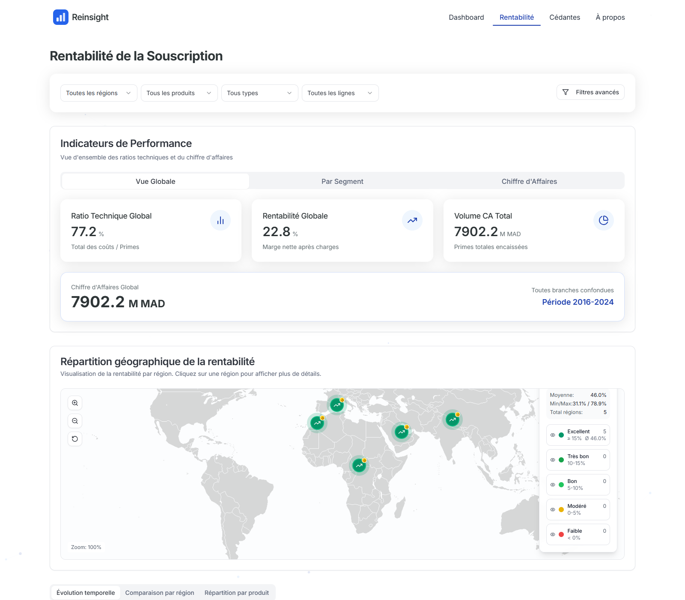

# Case study: exploring a reinsurance portfolio

**Personal project · Anonymised demo data with distorted amounts · React and FastAPI**

## Business problem

Which regions, lines of business and cedants warrant closer review when premiums,
claims, reserves and charges are considered together? The dashboard makes those
comparisons navigable instead of leaving them in a large underwriting file.

## My contribution and evidence

- Implemented file ingestion, segmentation, KPI calculations and typed endpoints
  in the [FastAPI backend](subscription_backend.py).
- Built the [profitability page](src/pages/Subscription.tsx),
  [cedant analysis page](src/pages/Cedantes.tsx) and
  [API integration](src/services/subscriptionService.ts), including filters and
  cedant selection.
- Documented [domain formulas and conventions](docs/NOTIONS_ET_FORMULES_REASSURANCE.md)
  and supplied a [demo-data preparation script](scripts/make_demo_dataset.py).

## Deliverables

A local React/FastAPI application, interactive charts, regional comparisons,
cedant search and detail views, documented endpoints and a
[gallery captured from the running application](screenshots/README.md).
The gallery records the demo data and selection used; it is not a static mockup.

## Decision supported

The views help a portfolio reviewer identify concentrations, compare loss and
technical ratios, and choose cedants or segments for further investigation.
Rankings exclude the latest underwriting year and require sufficient earlier
history to reduce misleading comparisons with immature business. No underwriting
decision, deployed client system or measured financial improvement is claimed.

## Data provenance and limitations

The [bundled demo dataset](data/README.md) contains approximately 62,000 rows
covering 2016–2024. Names and identifiers are replaced with generic values and
amounts distorted; results represent no real portfolio. Screenshots use this file,
not a private source supplied through `DATA_FILE`.

The backend loads a file into memory; there is no database, authentication or
scheduled refresh. Some modules are roadmap items and the home page uses sample
values. Profitability labels are not uniform across the source: loss-only margin
and margin after technical charges must be distinguished. See the
[existing-issues note](../portfolio-guide/EXISTING_ISSUES.md) before interpreting a view.

[Project overview and local run](README.md#run-locally) · [Gallery](screenshots/README.md) ·
[Implementation evidence](../portfolio-guide/BI_IMPLEMENTATION.md) · [Portfolio](../README.md)
