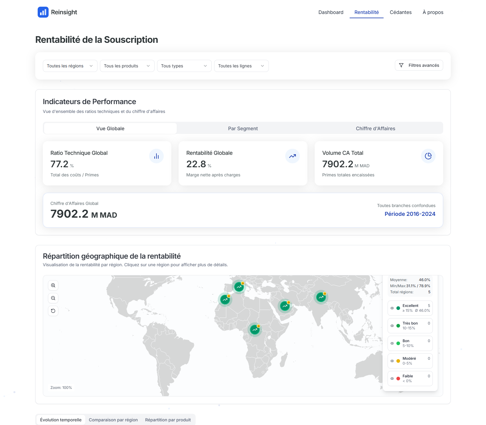

# Reinsight: running-application gallery

[Case study](../CASE_STUDY.md) · [Project and local run](../README.md#run-locally) ·
[Portfolio](../../README.md)

These are browser-automation captures of the **existing React frontend and
FastAPI backend**, taken locally with `DATA_FILE=data/demo_dataset.csv.gz`.
No API responses, chart data or application logic were replaced for the capture.
The data loader reported **61,690 demo rows**. Identifiers are anonymised and
amounts distorted; the images represent no real portfolio.

## Captures



| Image | State and purpose |
| --- | --- |
| [Profitability overview](profitability-overview.png) | Compact desktop view of `/subscription`; all regions, products, business types and lines; default global KPI tab |
| [Full profitability dashboard](profitability-dashboard.png) | Same default state, including annual charts, map and cedant rankings farther down the page |
| [Cedant overview](cedant-overview.png) | `/cedantes`, **Cédante 001** selected through the existing search interface; default branch filters |
| [Full cedant analysis](cedant-analysis.png) | Same selected cedant, with general, treaty and facultative views and tables |

The compact views are 1600 × 1400 desktop viewport screenshots. Full-page captures
also use a 1600-pixel width and retain the full page for detailed inspection; open
the image directly to read the charts at original resolution. The full cedant
capture retains the search UI's open helper popover; the compact capture dismisses
it while retaining the selection.

## Capture and verification

Captured on 2026-11-05 with Playwright and installed Microsoft Edge in headless
mode. The automation waited for a successful, populated subscription API response,
successful general/treaty/facultative analytics responses for Cédante 001,
visible Recharts SVGs and completed chart animations. It observed three chart SVGs
on the profitability view and sixteen on cedant analysis, with no browser page errors.

The headings, generic cedant/insured names and figures come from the existing
application. The global margin includes technical charges, whereas the regional
map and annual view use a loss-only margin; these should not be read as the same
metric. See [existing issues](../../portfolio-guide/EXISTING_ISSUES.md).

## Reproduce locally

Start both services using the project's [local run instructions](../README.md#run-locally).
Use the documented `http://localhost:8080` origin: default CORS settings do not
include `http://127.0.0.1:8080`. In a separate Python environment with Playwright
installed, run from the **portfolio root**:

```powershell
python maintenance/scripts/capture_reinsight.py
```

The script uses the installed Edge executable by default; `--browser` accepts an
alternate installed Chromium executable. During this review, Playwright was
installed in a temporary tools directory; project dependencies and lockfiles were
not changed. The script preserves existing captures and writes only missing
filenames. To intentionally refresh a differing image, first choose a new filename
in the script and review it before replacing any original.
