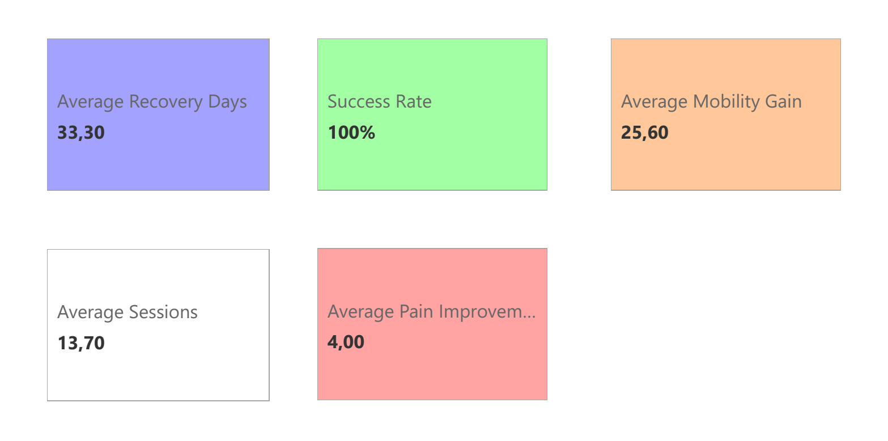

# Case study: rehabilitation KPI reporting

**Personal reporting project · 10 synthetic records · Python and Power BI**

## Reporting problem

How can a rehabilitation reporting workflow summarise treatment duration, changes
in pain and mobility, and a consistently defined success flag by injury type?

## My contribution and evidence

- Prepared the [Python ETL](src/etl_pipeline.py): exact duplicate removal, date
  conversion, recovery days, pain improvement, mobility gain and success flags.
- Organised [analysis notebooks](notebooks/), a
  [Power BI report file](powerbi/dashboard.pbix) and
  [four existing dashboard screenshots](screenshots/README.md).
- Added an explicitly separate [SQLite companion](sql/README.md) and a
  [comparison runner](sql/verify_companion.py) that calls the original Python
  functions and checks SQL rows and injury-type summaries against them.

## Deliverables

A synthetic source CSV, Python preparation workflow, notebooks, PBIX artifact,
dashboard gallery and runnable SQL evidence. PBIX internals, embedded DAX and
source bindings have not been independently inspected. The SQLite companion is
**not claimed to feed the existing report**.

## Decision supported

The report demonstrates how to compare recorded duration and outcome indicators
across injury groups and identify questions for review. It does not establish
treatment effectiveness, causal effects or a clinical recommendation. “Success”
means only **mobility gain > 20 AND pain improvement > 2**, the project's rule.

## Data provenance and limitations

The [bundled data](data/clinical_data.csv) comprises 10 wholly synthetic records,
not real patients. The verified Python/SQLite outputs average **33.30 recovery
days, 4.00 pain improvement and 25.60 mobility gain**, with **100% rule-based
success**. That uniformly successful sample has little variation for success-rate
analysis; it is not evidence of a real healthcare outcome.

The older technical narrative gives conflicting values, including 72% success;
the [review notes](../portfolio-guide/EXISTING_ISSUES.md) distinguish those claims from the
current CSV and screenshots. The ETL's “recovery days” is simply end date minus
start date, and the supplied code does not validate clinical score ranges or
automatically schedule refreshes.

[Project overview](README.md) · [Gallery](screenshots/README.md) ·
[SQLite instructions](sql/README.md) · [Implementation evidence](../portfolio-guide/BI_IMPLEMENTATION.md) ·
[Portfolio](../README.md)
