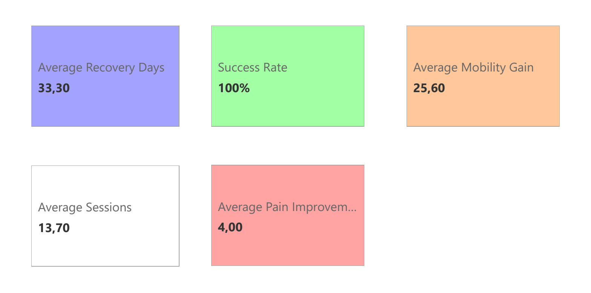
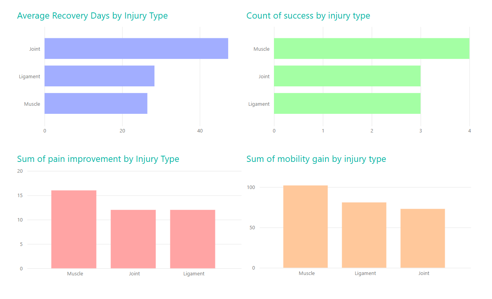
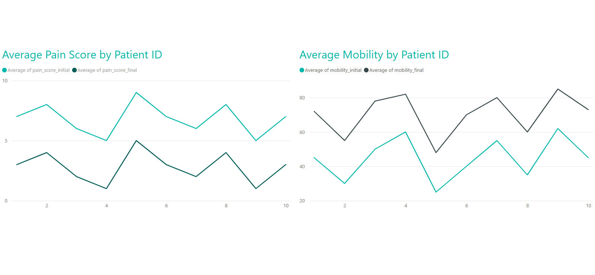
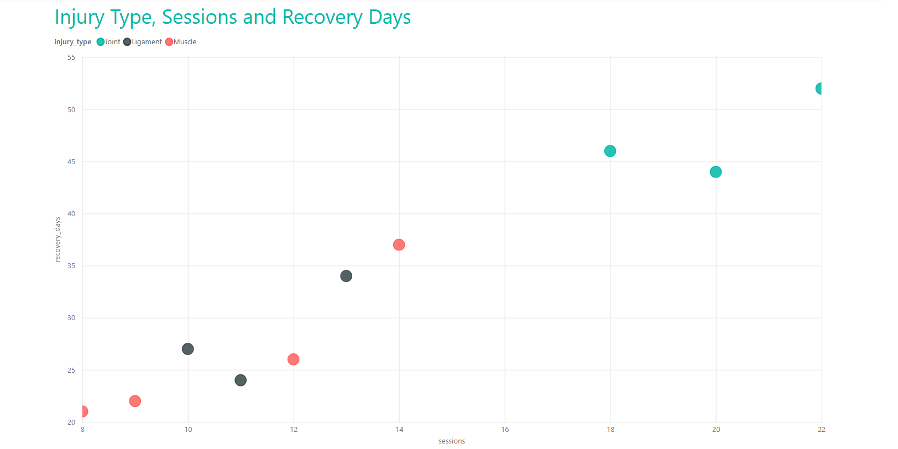

# 🏥 Clinical KPI Dashboard  
A personal healthcare reporting project using Python preparation and a supplied Power BI report.

This project simulates a real clinical rehabilitation workflow, transforming raw patient data into actionable insights through data cleaning, exploratory analysis, KPI generation and interactive dashboards.  
It demonstrates KPI definitions, Python data preparation and dashboard reporting on 10 synthetic records. Embedded DAX and PBIX model internals have not been independently audited.

[Short case study](CASE_STUDY.md) · [Screenshot gallery](screenshots/README.md) ·
[Verified SQLite companion](sql/README.md) · [Implementation evidence](../portfolio-guide/BI_IMPLEMENTATION.md) ·
[Portfolio](../README.md)

---

## 📊 Project Overview

This project analyzes synthetic clinical rehabilitation data, focusing on patient recovery, pain reduction, mobility improvement and treatment efficiency.  
The goal is to build a full analytical pipeline that mirrors real-world healthcare analytics tasks:

- Data ingestion  
- Data cleaning and validation  
- KPI creation  
- Exploratory Data Analysis (EDA)  
- Clinical visualizations  
- Power BI dashboard  
- Repeatable, manually run ETL

---

## 🧱 Project Structure
```
Clinical-KPI-Dashboard/
│
├── docs/
│   └── README_technical.md   # Technical Documentation
├── data/                     # Raw and cleaned datasets
│   ├── clinical_data.csv
│   └── README.md
│
├── notebooks/                # Jupyter notebooks for analysis
│   ├── data_cleaning.ipynb
│   ├── analysis.ipynb
│   └── visualizations.ipynb
│
├── src/                      # ETL pipeline
│   └── etl_pipeline.py
│
├── powerbi/                  # Power BI dashboard
│   └── dashboard.pbix
│
└── README.md                 # Main project documentation
```
---

## 📄 Technical Documentation

For a deeper explanation of the ETL pipeline, data cleaning logic, KPI calculations, and project architecture, see the full technical documentation:

👉 **[Technical README (docs/README_technical.md)](docs/README_technical.md)**

This document includes:
- Detailed ETL workflow  
- Data dictionary  
- KPI mathematical definitions  
- Python processing steps  
- Power BI data model explanation  
- Design decisions and limitations  

---

## 🏥 Clinical KPIs Included

### Recovery Metrics
- Average Recovery Days  
- Recovery Time Distribution  
- Recovery by Injury Type

### Pain & Mobility Metrics
- Pain Improvement  
- Mobility Gain  
- Patient Evolution Over Time

### Treatment Efficiency
- Sessions vs Recovery Days  
- Success Rate (clinical outcome)  
- Efficiency by Injury Type

---

## 🧪 Technologies Used

| Area | Tools |
|------|-------|
| Data Cleaning | Python, Pandas |
| Analysis | Python, Seaborn, Matplotlib |
| ETL | Python, Custom Pipeline |
| Dashboard | Power BI report artifact and screenshots; embedded DAX unverified |
| SQL companion | SQLite views, compared against the original Python ETL; separate from the PBIX |
| Documentation | Markdown, GitHub |

---

## ⚙️ ETL Pipeline

The ETL pipeline (`etl_pipeline.py`) performs:

- Loading raw clinical data  
- Removing duplicates  
- Converting date formats  
- Creating KPIs (recovery days, pain improvement, mobility gain, success flag)  
- Exporting cleaned dataset for analysis and dashboarding  

This provides a repeatable workflow when run manually. No scheduler is supplied.

---

## 📈 Power BI Dashboard

The dashboard includes:

### Page 1 — Overview
- Recovery KPIs  
- Pain & mobility KPIs  
- Success Rate  
- Sessions average  

### Page 2 — Injury Type Analysis
- Recovery by injury type  
- Success rate by injury type  
- Pain & mobility distribution  

### Page 3 — Patient Evolution
- Pain initial vs final  
- Mobility initial vs final  

### Page 4 — Treatment Efficiency
- Sessions vs recovery days  
- Efficiency insights  

The `.pbix` file is available in the `powerbi/` folder.

---

## 📸 Dashboard Screenshots

See the [indexed gallery](screenshots/README.md) for all four original images,
their interpretation and the comparison with the bundled CSV.

Below are key views of the Power BI dashboard included in this project.

### 🧭 Overview Page
The main KPI summary of the clinical dataset.



---

### 🩺 Injury Type Analysis
Average recovery days by injury type.



---

### 📈 Patient Evolution
Pain and mobility progression throughout treatment.



---

### ⚙️ Sessions Efficiency
Relationship between number of sessions and recovery performance.




---

## 🔬 Key Insights

The [Python-vs-SQL comparison](sql/README.md) verifies these descriptive results for
the current 10 synthetic records:

| Indicator | Value |
| --- | --- |
| Average recovery days (end minus start date) | 33.30 |
| Average pain improvement | 4.00 |
| Average mobility gain | 25.60 |
| Average sessions | 13.70 |
| Success under the project's threshold rule | 100% |

All records meet `mobility_gain > 20 AND pain_improvement > 2`; this sample cannot
support a claim that one injury group has a lower success rate. These are synthetic
descriptions, not evidence of treatment effectiveness. See the
[existing-issues note](../portfolio-guide/EXISTING_ISSUES.md) for older narrative discrepancies.

---

## 🚀 How to Run the Project

### 1. Run the ETL Pipeline
```bash
cd src
python etl_pipeline.py
cd ..
```

### 2. Open the Notebooks
Use Jupyter, VS Code or Google Colab.

### 3. Open the Power BI Dashboard
Load:
```
powerbi/dashboard.pbix
```

### 4. Explore the Data
Use the cleaned dataset:
```
data/clinical_data_cleaned.csv
```

### 5. Verify the separate SQL companion

From this project root, with pandas and numpy available:

```bash
python sql/verify_companion.py
```

This uses an in-memory SQLite database and compares the original Python functions
with SQL, without overwriting data. It is not claimed to power the existing PBIX.
For Power BI refresh, inspect source settings in Desktop first; this review does
not verify which file the report binds to.

---

📄 License
This project uses synthetic data, safe for public use.
Feel free to fork, study, or adapt the project.
