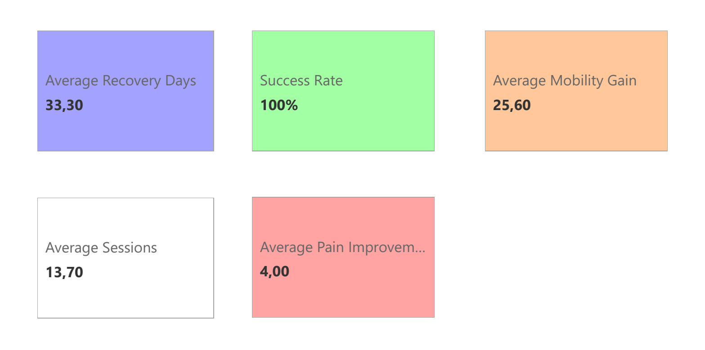

# Clinical reporting screenshot gallery

[Case study](../CASE_STUDY.md) · [Project](../README.md) · [Portfolio](../../README.md)

These four existing PNGs are retained in place, with their original filenames.
They are supplied Power BI screenshots, not newly captured or independently
audited PBIX internals. The source dataset has only 10 synthetic records.

| Screenshot | Reporting question |
| --- | --- |
| [Overview](dashboard_overview.png) | What are the headline duration, mobility, pain and success indicators? |
| [Injury-type analysis](dashboard_InjuryTypeAnalysis.png) | How do recorded durations differ by injury type? |
| [Patient evolution](dashboard_PatientEvolution.png) | How do initial and final recorded scores compare? |
| [Sessions efficiency](dashboard_SessionsEfficiency.png) | How do sessions and recorded duration vary together? |

The overview displays 33.30 average recovery days, 100% success, 25.60 mobility
gain, 13.70 sessions and 4.00 pain improvement. These agree with the bundled CSV
under the existing Python definitions and the new
[SQLite comparison](../sql/README.md). Agreement with those displayed totals does
not prove report source bindings or measure definitions.

“Recovery” is the recorded end/start date difference. “Success” is the project's
threshold rule, not a validated clinical outcome. The older technical narrative
contains conflicting figures; see [review notes](../../portfolio-guide/EXISTING_ISSUES.md).
