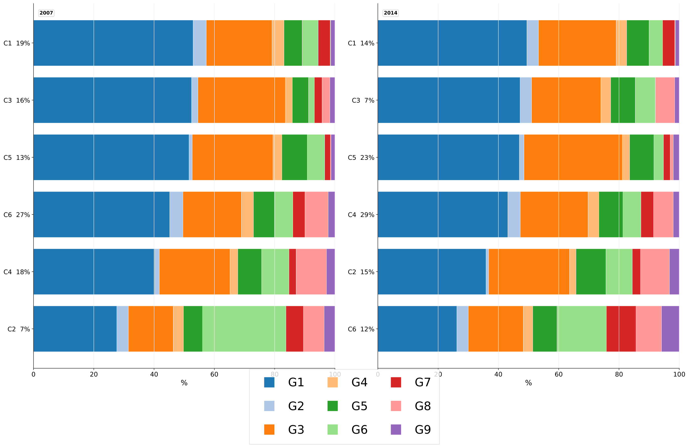

# Case study: understanding household consumption in Morocco

**Personal research project · Historical HCP survey data · Python, GAMS and Stata outputs**

## Research problem

How do household resources, location and demographic characteristics relate to
spending patterns? Averages alone can hide households with very different needs.
The study combines demand modelling with segmentation to describe that variation.

## My contribution and evidence

- Prepared budget-share matrices at 9- and 23-category levels; see the
  [matrix preparation scripts](dirichlet/matrix_creation/).
- Implemented finite Dirichlet mixtures and Bayesian alternatives, with model and
  prior comparisons: [DMM example](dirichlet/DMM/dmm_encdm_9.py),
  [DPMM example](dirichlet/DPMM/dpmm_encdm_9.py) and
  [methodology report](dirichlet/outputs/rapports/rapport_procedure_DMM_DPMM.md).
- Modelled consumption through [LES equations in GAMS](GAMS/2014_9.gms).
  The repository also retains [multilevel model-selection tables](Multiniveau/),
  rather than a fully reproducible Stata estimation workflow.
- Produced [survey-weighted K=6 profile tables](dirichlet/outputs/tables/profils_ponderees_K6/)
  and descriptive and segmentation figures.

## Deliverables

Research reports, elasticity tables, model diagnostics, household profile summaries
and a [visual gallery](screenshots/README.md). K=6 is the presentation compromise
described in the existing reports; it is not presented as a universally optimal
number of segments. New PNG previews render existing PDFs without re-estimation.

## Decision supported

The analysis helps a research or policy reader compare budget constraints,
territorial differences and distinct consumption profiles. It can inform questions
for further investigation or segmentation design. No policy adoption, commercial
use or measured intervention impact is claimed.

## Data provenance and limitations

Sources are HCP's ENNVM 2006–2007 and ENCDM 2013–2014, identified in the
[project data notes](README.md#data). These historical surveys do not describe
present-day household behaviour. Microdata are not supplied for reproduction;
public presentation uses existing aggregate outputs. Survey-weighted summaries
and model-based profiles answer different questions and should not be conflated.

The study lacks observed price/quantity data; LES price elasticities are structural
estimates. Model assumptions, tiny or ambiguous mixture components, prior
sensitivity and the missing formal Hausman/Mundlak check limit interpretation.
Cluster labels are interpretations, not fixed household identities across surveys.

[Project overview](README.md) · [Gallery and figure provenance](screenshots/README.md) ·
[Implementation evidence](../portfolio-guide/BI_IMPLEMENTATION.md) · [Portfolio](../README.md)
