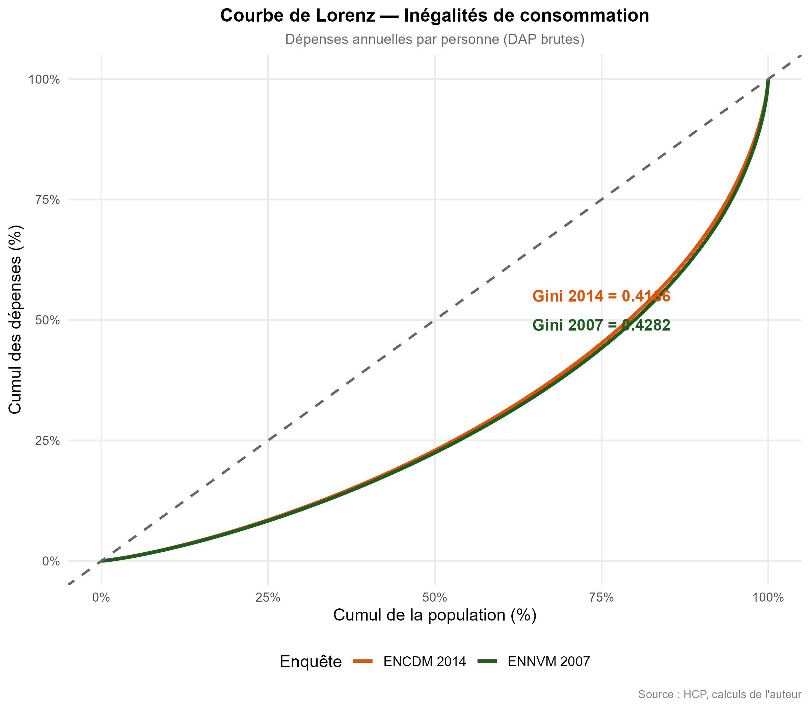
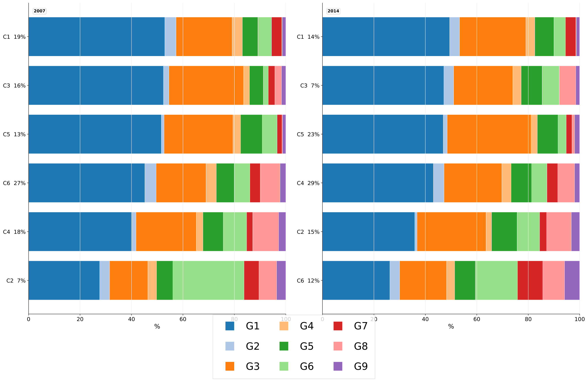

# Research figure gallery

[Case study](../CASE_STUDY.md) · [Project](../README.md) · [Portfolio](../../README.md)

These figures are existing research outputs from the historical HCP surveys.
Original PNGs and PDFs remain in place; the gallery links them instead of copying
them. Only the three PDF previews below are new files, rendered without rerunning
estimation or changing findings. French labels are retained.

## Descriptive analysis

| Figure | What to inspect |
| --- | --- |
| [Urban/rural sample distribution](../graphiques_echantillon/ech_01_repartition_milieu.png) | Survey sample context |
| [Regional sample distribution](../graphiques_echantillon/ech_03_repartition_region.png) | Geographic coverage |
| [Expenditure distribution](../graphiques_echantillon/ech_10_distribution_DAP.png) | Variation in annual expenditure per person |
| [Lorenz curves](../graphiques_echantillon/ech_16_courbe_lorenz.png) | Existing comparison of consumption inequality |
| [Expenditure and household-head education](../graphiques_echantillon/ech_14_depenses_instruction.png) | Descriptive socioeconomic comparison |



## Representative K=6 household profiles



The original figure compares 2007 and 2014. Cluster IDs/order are specific to each
fit; matching row positions does not establish the same households or longitudinal
transitions. G1–G9 denote food/beverages; clothing/footwear; housing/water/energy;
alcohol/tobacco; furnishing/equipment; health; transport; communication; and
leisure/culture/education, as defined in the
[results report](../dirichlet/outputs/rapports/rapport_resultats_DPMM_9postes_2007_2014.md#libelles-des-9-postes).
Read the existing figure percentages in their original model context; they are
not substituted for survey-weighted population shares.

| Figure | Source and context |
| --- | --- |
| [K=6 budget profiles: 9 categories](k6-budget-profiles-9-categories.png) | [Original PDF](../dirichlet/outputs/figures/dirichlet_313_separees_tres_lisibles/9postes/fig_02_barres_empilees_K6_9postes.pdf), page 1 |
| [K=6 socioeconomic profiles: 2014](k6-socioeconomic-profiles-2014.png) | [Original PDF](../dirichlet/outputs/figures/dirichlet_313_separees_tres_lisibles/9postes/fig_04_ancrage_socioeconomique_K6_2014_9postes.pdf), page 1 |
| [K=6 budget profiles: 23 categories](k6-budget-profiles-23-categories.png) | [Original PDF](../dirichlet/outputs/figures/dirichlet_313_separees_tres_lisibles/23postes/fig_02_barres_empilees_K6_23postes.pdf), page 1 |
| [2007 K=6 radar profiles](../dirichlet/outputs/figures/ennvm_2007_K6_radar_9postes_nonparam.png) | Existing PNG, nine-category profiles; original filename retained |
| [2014 K=6 radar profiles](../dirichlet/outputs/figures/encdm_2014_K6_radar_9postes_nonparam.png) | Existing PNG, nine-category profiles; original filename retained |
| [K selection and stability](../dirichlet/outputs/figures/dirichlet_313_separees_tres_lisibles/9postes/fig_03_qualite_stabilite_K_9postes.pdf) | Existing diagnostics PDF; not a new estimation |
| [Weighted K=6 profile tables](../dirichlet/outputs/tables/profils_ponderees_K6/) | Separate survey-weighted summaries |

## Preview provenance

PNG previews were rendered from page 1 of each linked PDF at 140 dpi using PyMuPDF.
For example, from this project root with PyMuPDF installed:

```python
from pathlib import Path
import pymupdf

source = Path("dirichlet/outputs/figures/dirichlet_313_separees_tres_lisibles/9postes/fig_02_barres_empilees_K6_9postes.pdf")
destination = Path("screenshots/k6-budget-profiles-9-categories.png")
if destination.exists():
    raise FileExistsError("Preserve the existing preview or choose a new name")
with pymupdf.open(source) as document:
    document[0].get_pixmap(dpi=140, alpha=False).save(destination)
```

No image content, category values or model results were edited. Reports remain
the source for methodology and interpretation; the microdata were not rerun.
