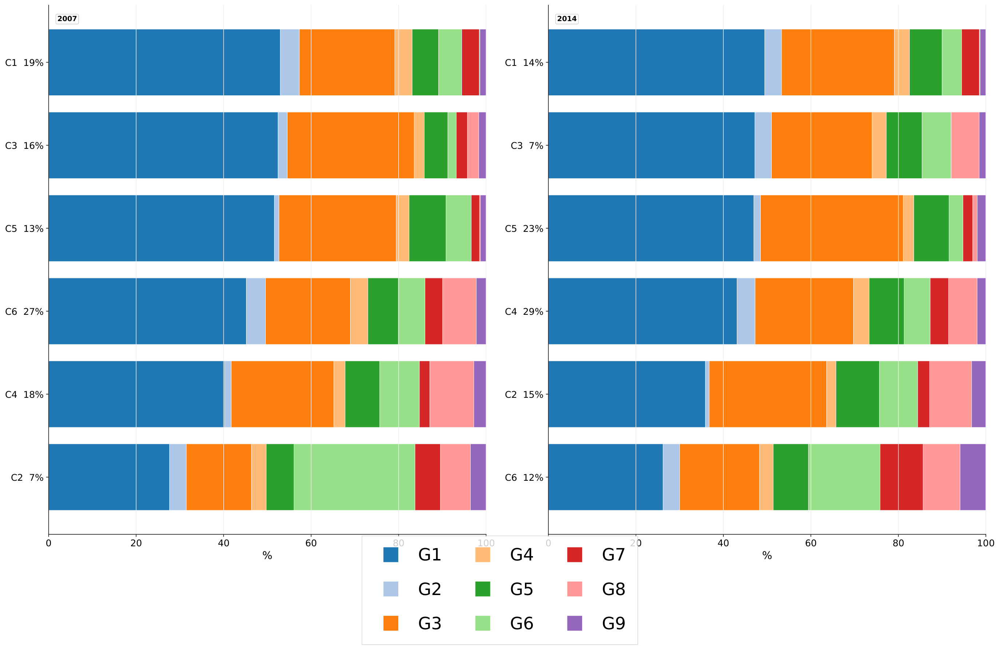
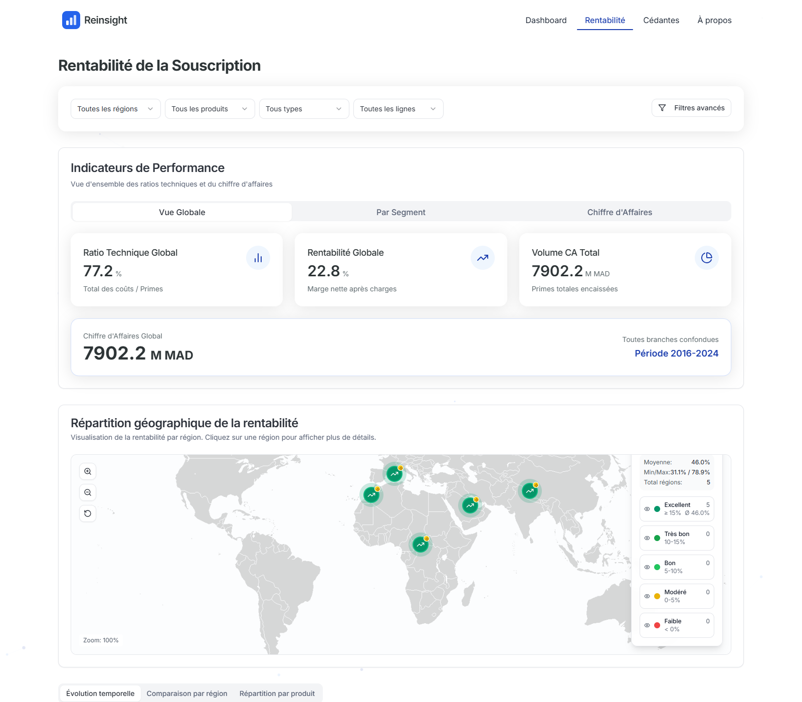
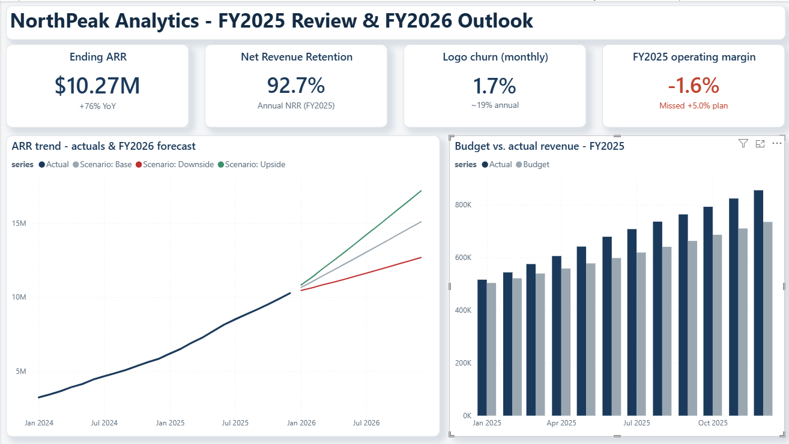
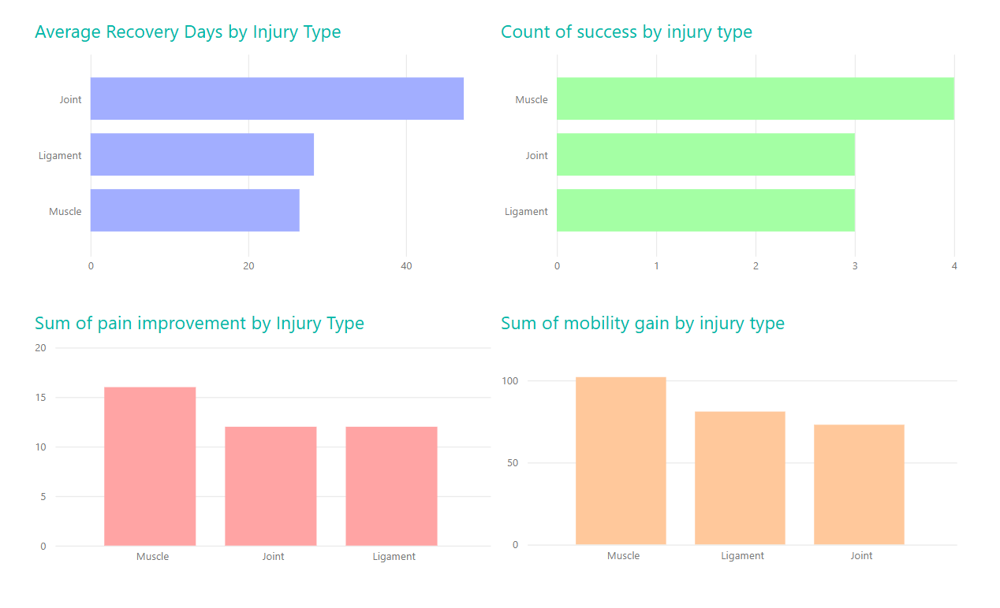

# Portfolio

Business intelligence, data analytics and research projects showing how I prepare
data, define useful metrics and communicate findings for review and decision-making.

## Start here

| What you want to see | Where to go |
| --- | --- |
| Research and advanced analytics | [Household consumption case study](Consommation_Maroc/CASE_STUDY.md) |
| Interactive dashboard development | [Reinsight case study](Actuariat_dashboard/CASE_STUDY.md) |
| Financial BI and forecasting | [NorthPeak case study](northpeak-fpna-main/CASE_STUDY.md) |
| Healthcare reporting | [Clinical KPI case study](Clinical-KPI-Dashboard-main/CASE_STUDY.md) |
| Code, DAX, refresh and validation evidence | [BI implementation index](portfolio-guide/BI_IMPLEMENTATION.md) |
| Folder layout and maintenance commands | [Repository guide](portfolio-guide/README.md) |

Each project follows the same entry points: **README.md** for the overview,
**CASE_STUDY.md** for the short story, and **screenshots/README.md** for the gallery.
The four original project folders contain the work; `portfolio-guide/` holds shared reference
material and `maintenance/` holds optional maintenance tools and browser-demo sources.

## Services

- **Power BI dashboards and KPI reporting:** clear views of financial,
  operational and healthcare indicators, with documented definitions.
- **Data preparation and validation:** Python transformations, reproducible
  calculations, reconciliation checks and a verified SQLite reporting companion.
- **Financial analytics:** budget-vs-actual reporting, driver-based forecasts,
  scenario comparisons and management briefs.
- **Advanced analytics and research:** household segmentation, econometric
  modelling, model diagnostics and interpretation of analytical limitations.
- **Analytics consulting:** KPI scoping, documented assumptions and concise
  recommendations grounded in the analysis.

These personal projects demonstrate approaches and deliverables. They are not
client engagements or evidence of measured business impact.

[Browse implementation evidence](portfolio-guide/BI_IMPLEMENTATION.md) ·
[Review limitations and existing issues](portfolio-guide/EXISTING_ISSUES.md)

## Featured work

### Consommation_Maroc — research depth and household segmentation

**Research question:** How do household resources, location and demographics relate
to consumption patterns, and which distinct budget profiles emerge?

Historical Moroccan household survey analysis combining expenditure models,
multilevel results and Dirichlet mixture segmentation. Deliverables include
methodology reports, elasticity tables, diagnostics and profile summaries.
**Data:** HCP surveys from 2007 and 2014; historical research outputs, with microdata
not included for reproduction. The interactive research dashboard remains a future step.

[Case study](Consommation_Maroc/CASE_STUDY.md) ·
[Project and methods](Consommation_Maroc/README.md) ·
[Figure gallery](Consommation_Maroc/screenshots/README.md)

### Reinsight — interactive dashboard development

**Business question:** Which regions, lines of business and cedants warrant a
closer look when premiums, claims, reserves and charges are compared?

A React/FastAPI application with profitability filters, regional comparisons,
annual trends and cedant analysis. Screenshots are captured from the existing
application with API data loaded. **Data:** anonymised demo identifiers and
distorted amounts; the displayed results represent no real portfolio.

[Case study](Actuariat_dashboard/CASE_STUDY.md) ·
[Project and local run](Actuariat_dashboard/README.md#run-locally) ·
[Dashboard gallery](Actuariat_dashboard/screenshots/README.md)

### NorthPeak — financial BI and planning

**Business question:** Why did a revenue beat coincide with an operating loss,
and how would different growth and cost assumptions change the next-year plan?

A SaaS FP&A workflow connecting Python forecasts, budget variance, planning
scenarios, a Power BI report and an executive memo. **Data:** entirely synthetic,
for a fictional business. Forecast accuracy and financial results belong to that
simulation; they are not client outcomes or promises of future accuracy.

[Case study](northpeak-fpna-main/CASE_STUDY.md) ·
[Project and local run](northpeak-fpna-main/README.md#how-to-run) ·
[Dashboard and chart gallery](northpeak-fpna-main/screenshots/README.md)

### Clinical KPI Dashboard — healthcare reporting

**Reporting question:** How do recorded treatment duration, pain improvement and
mobility gain compare across injury types under consistent KPI definitions?

A Python preparation workflow and Power BI report with an additional, independently
verified SQLite companion. **Data:** 10 synthetic records, not real patients.
“Success” is a project threshold rule; this sample does not establish clinical effectiveness.

[Case study](Clinical-KPI-Dashboard-main/CASE_STUDY.md) ·
[Project and local run](Clinical-KPI-Dashboard-main/README.md) ·
[Dashboard gallery](Clinical-KPI-Dashboard-main/screenshots/README.md) ·
[Runnable SQL evidence](Clinical-KPI-Dashboard-main/sql/README.md)

## Reviewing the work

Start with a short case study and gallery, then use the
[evidence index](portfolio-guide/BI_IMPLEMENTATION.md) to inspect source calculations,
documented model designs, DAX examples, manual refresh instructions and validation.
PBIX files are supplied artifacts; their internal model and measures have not been
independently audited in this review.

The existing demo references below are retained from the checkout. This
presentation update does not deploy, publish or change those sites; the local run
instructions and galleries are sufficient to review the featured work.

## Live interactive demos

Explore these projects directly in your browser:

| Project | Demo | Source |
| --- | --- | --- |
| **NorthPeak Analytics — SaaS FP&A** | [Open demo](https://northpeak-analytics-mouade.appreciativebow.chatgpt.site) | [Project and methodology](northpeak-fpna-main/) |
| **Reinsight — Reinsurance Analytics** | [Open demo](https://reinsight-analytics-mouade.appreciativebow.chatgpt.site) | [Project and methodology](Actuariat_dashboard/) |

NorthPeak explores executive KPIs, budget variance and forecasting scenarios using
synthetic data. Reinsight explores portfolio profitability, regional performance
and cedants using anonymised, distorted demo data.

These public browser adaptations require no local installation. The original
Power BI, Python and React deliverables remain in their project directories.

