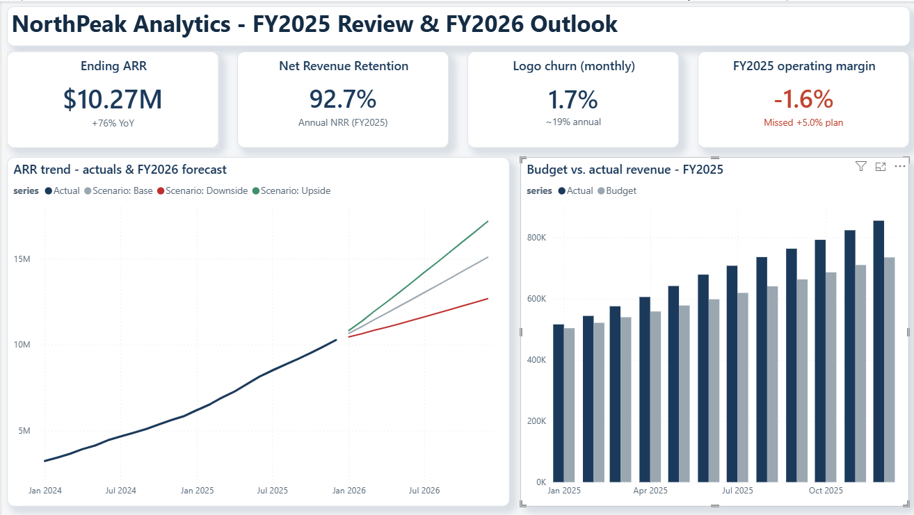

# Case study: SaaS growth, budget variance and planning

**Personal portfolio project · Fictional business · Entirely synthetic data**

## Business problem

In a fictional subscription business, revenue exceeds budget but operating profit
falls short. What explains the gap, and how do customer acquisition, retention and
cost assumptions change the following year's plan?

## My contribution and evidence

- Built a [driver-based forecasting and holdout-backtest workflow](src/forecast.py)
  using customer acquisition, churn, pricing and expansion.
- Developed [budget-vs-actual calculations and an operating-income bridge](src/variance.py),
  then [three assumption-driven scenarios](src/scenarios.py).
- Prepared [long-format Power BI inputs](src/dashboard.py), a
  [documented report design with DAX examples](outputs/DASHBOARD_GUIDE.md),
  [reconciliation checks](src/validate.py) and an
  [executive memo](outputs/EXECUTIVE_MEMO.md).

## Deliverables

A [Power BI report file](outputs/northpeak_dashboard.pbix),
[three dashboard screenshots and analytical charts](screenshots/README.md),
[Excel variance workbook](outputs/variance_analysis.xlsx),
[scenario export](outputs/scenarios.csv) and decision brief.
The model relationships and DAX in the build guide are documented design evidence;
this review has not independently audited the PBIX's internal measures or refresh.

## Decision supported

The simulation separates revenue growth from cost control, compares the planned
and actual P&L, and frames a range of next-year outcomes. It supports discussion of
spending limits, retention priorities and monthly performance monitoring.

The source memo reports a simulated FY2025 revenue beat of about $888K, a $132K
operating loss, and FY2026 base-case exit ARR of about $15.1M. These are **results
inside the fictional dataset**, not client results or financial advice.

## Data provenance and limitations

[Generation code](data/generate_data.py) and the
[data dictionary](data/DATA_DICTIONARY.md) describe the synthetic inputs. The
reported **3.9% ARR MAPE** comes from a six-month holdout in this simulation; it
does not establish accuracy on an actual business or other datasets. The limited
history and model assumptions constrain extrapolation. Upside/base/downside cases
are planning assumptions, not statistical confidence intervals.

[Project overview and run instructions](README.md) · [Gallery](screenshots/README.md) ·
[Implementation evidence](../portfolio-guide/BI_IMPLEMENTATION.md) · [Portfolio](../README.md)
