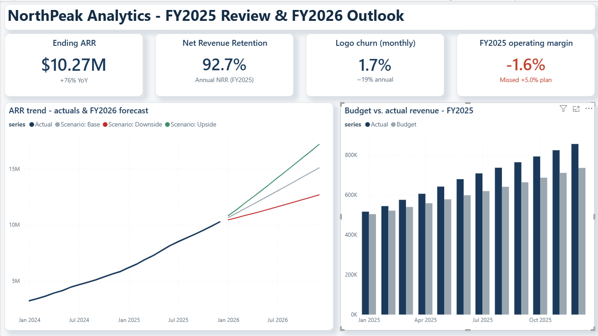

# NorthPeak dashboard and analysis gallery

[Case study](../CASE_STUDY.md) · [Project](../README.md) · [Portfolio](../../README.md)

All images below are retained originals in `outputs/figures/`, preserving script
paths and existing links. No duplicate image copies were added. All amounts and
results describe a fictional SaaS business with synthetic data.

## Power BI dashboard pages

| View | Purpose |
| --- | --- |
| [Page 1: executive summary](../outputs/figures/dashboard_page1.png) | ARR, retention, churn, operating margin and revenue vs. budget |
| [Page 2: variance analysis](../outputs/figures/dashboard_page2.png) | Operating-income bridge and line-by-line comparisons |
| [Page 3: scenarios](../outputs/figures/dashboard_page3.png) | FY2026 planning cases and revenue movements |

These existing screenshots show report appearance, not independent verification
of embedded DAX, relationships or refresh. Some screenshots retain editor chrome;
they have not been altered to imply a new report capture.

## Python-generated analytical charts

| Figure | Source workflow |
| --- | --- |
| [FY2026 ARR forecast](../outputs/figures/forecast_fy2026.png) | [Forecast and synthetic-data holdout](../src/forecast.py) |
| [Forecast drivers](../outputs/figures/forecast_drivers.png) | Acquisition, churn and other model drivers |
| [Operating-income variance bridge](../outputs/figures/variance_bridge.png) | [Variance engine](../src/variance.py) |
| [Variance by P&L line](../outputs/figures/variance_by_line.png) | Budget/actual comparison |
| [ARR scenario range](../outputs/figures/scenario_arr.png) | [Scenario assumptions and engine](../src/scenarios.py) |

The scenario range is assumption-driven, not a confidence interval. The reported
3.9% ARR MAPE belongs to this fictional simulation's six-month holdout.
See the [build guide](../outputs/DASHBOARD_GUIDE.md),
[memo](../outputs/EXECUTIVE_MEMO.md) and
[implementation evidence](../../portfolio-guide/BI_IMPLEMENTATION.md) for interpretation.
